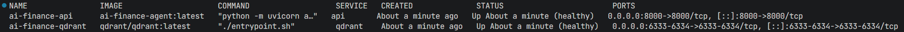
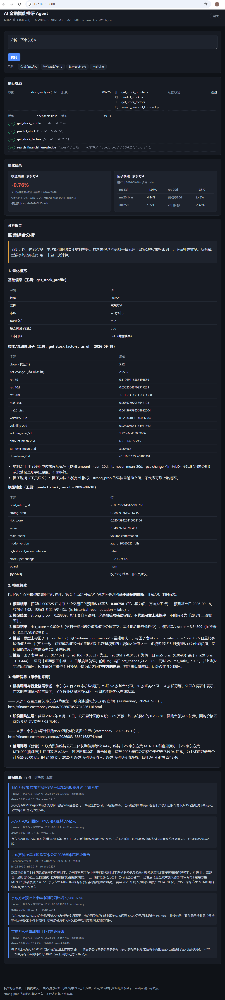
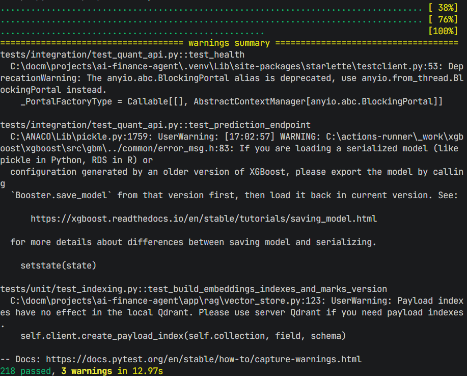

# AI 金融智能投研 Agent

在《基于 XGBoost 的 A 股选股分析系统》之上做的二次开发：
把遗留量化系统升级为「量化引擎 + 金融知识库 + 受控 Agent + Web UI + 离线评测」的完整作品。

> **定位**：不是"套壳 RAG 聊天框"，而是**在遗留量化系统上做可信 AI 工程化**——
> 量化结果与带来源的文本证据统一编排，且一切可量化评测。

| 维度 | 现状 |
| --- | --- |
| 量化引擎 | XGBoost 双模型（回归 + 分类），**1,577,076 行因子 / 1,044 只股票**，行情推进至 **2026-09-18**；新旧引擎对拍 **5/5 一致（max_abs_diff=0）** |
| 知识库 | 7,743 篇新闻 + **4,623 篇官方公告（巨潮 cninfo，含 PDF 正文）**，共 **109,554 chunks**（公告 101,811 / 新闻 7,743；32 只股票 × 近一年） |
| 检索 | BGE-M3 dense + BM25(jieba) → RRF(k=60) → bge-reranker-v2-m3；热态 **32~376ms** |
| Agent | LangGraph 受控工作流，5 个工具；单次问答 = 1 批计划工具 + 最多 5 轮 LLM 追加（`MAX_ITERATIONS=6`），最多 12 次调用、单工具超时 60s；多股票比较按股票逐只调用，结果按键区分（`predict_stock:600519`） |
| 评测 | **36 题评测集 / 373 条标注**，四组对照实验 + RRF 参数敏感性分析（Recall/Precision/MRR/NDCG/Latency） |
| 测试 | **218 passed** |

---

## 架构

```text
                        ┌──────────────────────────────┐
                        │   Web UI (单页, 无框架/CDN)   │
                        │  报告 · 量化卡片 · 证据来源    │
                        └───────────────┬──────────────┘
                                        │ POST /api/chat, /api/rag/search
                        ┌───────────────▼──────────────┐
                        │        FastAPI Gateway        │
                        │   结构化错误 {code, message}   │
                        └───────────────┬──────────────┘
                                        │
                        ┌───────────────▼──────────────┐
                        │   LangGraph 受控 Agent        │
                        │  query_analyzer               │
                        │  → stock_resolver             │
                        │  → task_planner (确定性计划)   │
                        │  → tool_execution_loop (≤6 轮) │
                        │  → evidence_validator         │
                        │  → report_generator (LLM)     │
                        └──────┬─────────────────┬──────┘
                               │                 │
                 ┌─────────────▼──────┐   ┌──────▼─────────────────────┐
                 │   Quant Tools      │   │   RAG Tool                 │
                 │ get_stock_profile  │   │ search_financial_knowledge │
                 │ get_stock_factors  │   └──────┬─────────────────────┘
                 │ predict_stock      │          │
                 │ rank_stocks        │   ┌──────▼─────────────────────┐
                 └─────────┬──────────┘   │ Hybrid Retrieval           │
                           │              │ dense(BGE-M3) ┐            │
                 ┌─────────▼──────────┐   │ BM25(jieba)   ├→ RRF →Rerank│
                 │ Quant Engine       │   └──────┬────────┘            │
                 │ 因子/预测/评分/排名 │          │                     │
                 └─────────┬──────────┘   ┌──────▼─────────────────────┐
                           │              │ Qdrant (109,554 points)    │
                 ┌─────────▼──────────┐   │ payload: stock/doc_type/ts │
                 │ SQLite             │   └────────────────────────────┘
                 │ 行情/因子/文档/chunks│
                 └────────────────────┘
                           │
                 ┌─────────▼──────────┐
                 │ DeepSeek (LLM)     │  只做理解/路由/组织证据/解释
                 └────────────────────┘
```

**职责边界（铁律）**：LLM **不做量化计算**，只通过工具拿结构化结果；
量化工具与 HTTP API 调用**同一套 service**，错误码完全一致。

---

## 快速开始

### 方式一：Docker（Qdrant + API + UI）

```bash
# 只在没有 .env 时复制：直接覆盖会清掉已填好的 LLM_API_KEY
[ -f .env ] || cp .env.example .env
# PowerShell: if (-not (Test-Path .env)) { Copy-Item .env.example .env }
# 至少填 2 项：LLM_API_KEY、LLM_MODEL=deepseek-flash
# Docker 方式不需要设 QDRANT_URL（compose 内已注入 http://qdrant:6333）；
# 本地方式见「已知限制」第 6 条：务必显式指定，且暂不要写进 .env
docker compose -f docker/docker-compose.yml up -d --build
# 打开 http://127.0.0.1:8000/
```

GPU 版本（embedding/reranker 走 CUDA，需要 NVIDIA Container Toolkit / WSL2）：

```bash
docker compose -f docker/docker-compose.yml --profile gpu up -d --build api-gpu
```

### 方式二：本地 Python

```powershell
py -3.12 -m venv .venv
.\.venv\Scripts\python.exe -m pip install -r requirements.txt
# 可选 GPU：pip install torch --index-url https://download.pytorch.org/whl/cu126

# 数据与模型（不进 Git，需从备份复制）
Copy-Item <备份>\stock_system.db data\
Copy-Item <备份>\models\* models\

# 知识库（首次）
$env:QDRANT_URL = "http://localhost:6333"
.\.venv\Scripts\python.exe scripts/ingest_news.py
.\.venv\Scripts\python.exe scripts/ingest_announcements.py --days 365 --max-bodies 300
.\.venv\Scripts\python.exe scripts/build_embeddings.py
.\.venv\Scripts\python.exe scripts/build_bm25.py

# 启动（UI 与 API 同进程）
.\.venv\Scripts\python.exe -m uvicorn app.main:app --host 127.0.0.1 --port 8000
```

---

## 效果示例

以下为**一次真实运行的历史输出**（当时量化基准日为 2026-06-24）。现在行情已推进至 2026-09-18，
"基准日早于新闻时间"的提示在当前数据下通常不再出现（基准日由数据决定，逻辑本身仍在）：

```text
$ python scripts/ask.py "分析一下京东方A"
intent=stock_analysis (source=rule) stocks=['000725']
plan=[get_stock_profile, predict_stock, get_stock_factors, search_financial_knowledge]
  tool get_stock_profile ok=True   tool predict_stock ok=True
  tool get_stock_factors ok=True   tool search_financial_knowledge ok=True (5 条证据)
evidence=5 evidence_ok=True elapsed=33.8s
```

生成报告的真实片段（体现"可信"而不是"能聊"）：

> **重要前置说明：量化数据的基准日（2026-06-24）早于检索到的多条新闻/公告时间（最晚 2026-08-31）。
> 两者不是同一时点，不能直接拼接为"当前状态"。**
>
> ……`strong_prob` 是**弱信号辅助字段，不代表可靠上涨概率**——不得将其解读为"上涨概率 30.7%"。
>
> ……模型预测 5 日为负收益（-3.07%），但同一基准日的实际动量因子全部为正（ret_5d +16.07%）。
> 二者方向不一致。工具未提供该因子的贡献方向，因此**不做推断**。

---

## 检索评测（P9）

**评测集**：36 题 / 373 条标注文档，覆盖 5 类查询（股票代码 / 公司简称 / 日期约束 /
公告类型与法律术语 / 语义事件问句）。标签由显式规格（股票 + 类型 + 日期窗口 + 标题关键词）
从数据库解析后**冻结**，评测时不再重新推导。
**指标**：Recall@K、Precision@K、MRR、NDCG@K（排名按文档去重后计算）、覆盖文档数、端到端延迟。
**统一预算协议**：`candidate-k = fusion-k = final-k = 20`，`BM25_WINDOW = 0`（全库打分后过滤）——
四种配置拿到**完全相同的 chunk 预算**，计分口径一致（见下"协议修正"）。

### 带元数据过滤（贴近 Agent 实际用法）

| 配置 | Recall@5 | Recall@10 | Precision@5 | MRR | NDCG@5 | 中位延迟 |
| --- | --- | --- | --- | --- | --- | --- |
| BM25-only | 0.4351 | 0.5332 | 0.4056 | 0.6672 | 0.5876 | **14 ms** |
| Dense-only | 0.3922 | 0.4766 | 0.3278 | 0.5752 | 0.4840 | 29 ms |
| Hybrid (RRF k=60) | 0.4248 | 0.5484 | 0.4056 | 0.6847 | 0.5883 | 41 ms |
| **Hybrid + Reranker** | **0.4563** | **0.5601** | **0.4444** | **0.7119** | **0.6366** | 452 ms |

### 不带过滤（更难：必须全库判别）

| 配置 | Recall@5 | Recall@10 | Precision@5 | MRR | NDCG@5 | 中位延迟 |
| --- | --- | --- | --- | --- | --- | --- |
| BM25-only | 0.3205 | 0.4640 | 0.3333 | 0.5758 | 0.4744 | **14 ms** |
| Dense-only | 0.2960 | 0.3999 | 0.2611 | 0.4495 | 0.3666 | 47 ms |
| Hybrid (RRF k=60) | 0.3586 | 0.4990 | 0.3611 | 0.5707 | 0.4896 | 43 ms |
| **Hybrid + Reranker** | **0.4492** | **0.5370** | **0.4222** | **0.6636** | **0.6044** | 441 ms |

> **协议修正（重要）**：早期版本的评测脚本里，BM25/Dense 只取 10 个 chunk 而 Hybrid 取 20+20 融合 15，
> 由于指标按文档去重计算，**各配置的预算并不相等**。修正后四种配置统一 `final-k=20`。
> 修正前后的数字**不可直接比较**（属于评测协议变更，不是检索效果变化）：
> 旧表见 `docs/evaluation_before_fix.md`，新表见 `docs/evaluation_after_fix.md`。

### RRF 参数：敏感性分析后保持默认（k=60 + 等权）

对融合参数做过完整敏感性分析：**12 格网格**（`RRF_K ∈ {10,30,60,100}` × `dense:bm25 ∈ {1:1,1:2,1:3}`）
× **2-fold 稳定性检查** × **reranker 短名单校验**。结论是**保持默认 `k=60` + 等权**：

- 唯一在带过滤设定上明显更高的组合（k=30、BM25 权重 3）在**不带过滤**设定下反而**低于默认 0.014**，
  且使最终带 reranker 的 **R@10 下降 0.038** —— 默认参数在**跨场景与 reranker 流水线下更稳定**；
- 分析还给出两个结构性结论：**等权时 `k` 只改变融合顺序、不改变候选集合**，对带 reranker 的最终结果无影响；
  **加权会改变候选集合**，能提升 MRR/NDCG（排序质量）但降低 R@10（召回覆盖）；
- 完整 12 格数据、2-fold 表、决策规则与局限声明见 `docs/rrf_parameter_experiment.md`。

### 结论（含反直觉处）

1. **Hybrid + Reranker 在两种设定下全面最优**；reranker 是单项收益最大的组件
   （带过滤 +0.03、不带过滤 +0.09 Recall@5，代价约 +410ms）。
2. **BM25 单独强于 Dense 单独**：本语料/题集中股票代码、公司简称、法律术语等**精确 token** 权重很高。
3. **融合的收益取决于两路候选的互补程度**：不带过滤时 Hybrid 明显高于 BM25-only
   （0.3586 > 0.3205）；带过滤时候选集被 metadata 压小、两路高度重合，Hybrid(0.4248) 略低于 BM25-only(0.4351)。
4. **日期类查询必须靠元数据过滤**：不过滤时 dense 在 date 类上 Recall@5 掉到 0.0059，
   向量"理解"不了日期。
5. **语义类查询上 dense 反超 BM25**（0.233 vs 0.206），符合预期。

> 复现：`python scripts/evaluate_retrieval.py [--ignore-filters] [--final-k 20]`
> 参数实验复现：`python scripts/grid_rrf.py --setting filtered --rerank-shortlist`

**评测局限（如实声明）**：标签源自标题关键词，对词面匹配（BM25）天然略有利；
每类仅 5~11 题，跨类比较只作方向性参考；样本量不支持显著性检验。

---

## 工程原则如何落地

| 原则 | 落地方式 |
| --- | --- |
| LLM 不做量化计算 | Agent 只有 5 个工具，无 SQL/Shell/文件工具（有测试守住）；量化工具与 API 共用同一 service |
| 无数据不造数据 | 全部错误结构化（`NoData`/`StockNotFound`/`ModelUnavailable`/`LLMUnavailable`…）；空结果显式 `has_evidence=false`，**无 sample_data 回退** |
| 证据可追溯 | 检索结果强制校验 `chunk_id/document_id/stock_code/doc_type/title/source/publish_time/url/content`，缺一即抛 `EvidenceMetadataMissing`；校验器另检查证据与量化结果的股票主体是否属于本次查询 |
| 弱信号不得夸大 | `strong_prob`（分类 recall≈0.0005，见 `models/model_metrics.json`）在工具 schema、工具返回值与系统 prompt 多处标注"弱信号辅助字段" |
| 工具边界 | 白名单 + 单工具超时（到期立即返回 `ToolTimeout`；被放弃的调用无法终止，见「已知限制」第 7 条）+ 最大 6 轮（1 批计划工具 + 最多 5 轮 LLM 追加）/ 最多 12 次调用；越权调用记为 `ToolNotAllowed`，预算耗尽时未执行的调用记为 `ToolCallBudgetExceeded` |
| 不静默回退 | `as_of` 无数据返回 `NoData`，绝不回退 latest；向量带 `embedding_version`，不同版本不混库 |
| 密钥不入库 | 全部走 `.env`（已接线到 `os.environ`）；DB / pkl / 向量库 / 模型权重均 gitignore |

---

## API

| Method | Endpoint | 说明 |
| --- | --- | --- |
| GET | `/api/health` | 健康检查（含各表行数） |
| GET | `/api/stocks/{code}/factors?as_of=` | 因子（支持历史时点） |
| GET | `/api/stocks/{code}/prediction?as_of=` | XGBoost 预测 + 风险 + 评分 |
| GET | `/api/stocks/ranking?top_n=&board=` | 选股排名（仅入池股票） |
| POST | `/api/rag/search` | 混合检索，返回带来源证据与四路分数 |
| POST | `/api/chat` | Agent 问答，返回报告 + 执行轨迹 + 量化结果 + 证据 |
| GET | `/` | Web UI |

错误统一为 `{"detail": {"code": "...", "message": "..."}}`。

---

## 项目结构

```text
app/
├── main.py            FastAPI 入口（同时提供 UI）
├── api/               stocks / rag / chat 路由
├── agents/            LangGraph 状态机、策略边界、prompt、LLM 客户端
├── tools/             5 个 Agent 工具 + 注册表 + 结构化错误边界
├── rag/               sources(东财/cninfo) · cleaner · chunker · ingestion
│                      embedding(BGE-M3) · vector_store(Qdrant) · bm25 · hybrid
│                      reranker · retrieval · indexing · eval_metrics · migrate
├── quant/             因子 / 预测 / 评分 / 排名（纯逻辑，源自早期版本）
├── services/          Stock / Prediction 服务契约（API 与工具共用）
└── schemas/           Pydantic 输出契约
scripts/               抓取/建库 ingest_* · build_embeddings · build_bm25 · build_eval_set · purge_documents
                       评测 evaluate_retrieval · grid_rrf · bench_retrieval
                       入口 ask · search_chunks · search_hybrid
                       运维 update_daily · rebuild_factors · predict_latest · migrate_qdrant
                       审计/工具 scan_publish_ts · verify_consistency · legacy_baseline_runner · init_db · backfill_publish_ts
frontend/              单页 UI（无框架、无 CDN）
docker/                Dockerfile(CPU) · Dockerfile.gpu · docker-compose.yml
docs/                  技术说明与离线实验材料（时区语义 / BM25 一致性 / RRF 实验 / 评测对照）
data/eval/             冻结的评测集与实验结果
```

---

## 数据来源与规模

- **行情/因子**：本地 SQLite（2020-01-02 ~ **2026-09-18**，**1,044 只股票**，**161 万日线**，**157.7 万因子行**）
- **新闻**：东方财富（7,743 篇，近一年）
- **公告**：**巨潮资讯网 cninfo（官方披露平台）**，4,623 篇，含 PDF 正文解析 ——
  东财公告正文接口存在 IP 级风控，故改用官方源（并保留了东财作为可选降级源）
- **模型**：XGBoost `xgb-b-20260625-fulla`（Rank IC 0.0737 / Top20 +1.85%）；
  Embedding `BAAI/bge-m3`；Reranker `BAAI/bge-reranker-v2-m3`
- **LLM**：DeepSeek（OpenAI 兼容，`deepseek-flash`）

## 已知限制

1. **行情已增量更新至 2026-09-18**，与新闻/公告时间基本对齐；若长期不更新，量化基准日会落后于
   文本时间，Agent 会主动提示两者不同时点。
2. **因子/预测覆盖 1,044 只**（最近交易日 1,043 只入池）。有 5 只（比亚迪 002594、宁德时代 300750、
   招商银行 600036、隆基绿能 601012、中国平安 601318）只有新闻公告、无因子行，量化查询按契约
   返回 `NoData`（**预期行为，非 bug**）。
3. 冷启动首次请求需加载 embedding + reranker（约 30s）；生产部署应在启动钩子预加载。
4. 大年报正文在清洗阶段截断于 20 万字符：当前语料 **64 篇公告**受影响（全部为公告，新闻 0 篇）。
5. 评测集 36 题，类别样本偏小；标签来源偏词面。
6. **本地模式陷阱**：不显式设置 `QDRANT_URL` 时，宿主脚本与本地 API 会**静默**切到本地模式
   `data/qdrant`，而那份旧副本同样含 109,554 点——靠点数分辨不出两个库，日期过滤可能直接 0 命中。
   容器内由 compose 的 `environment` 覆盖（始终为 `http://qdrant:6333`）；宿主侧请在运行时显式设置，
   **暂不要写进 `.env`**：`ChunkVectorStore._build_client` 目前会让该变量覆盖显式传入的 `path=`，
   会误伤迁移工具的本地源、本地基准列与向量相关单元测试（详见 `.env.example` 内注释）。

7. **工具超时是"放弃等待"而不是"杀死调用"**：单个工具超过 60s 时，Agent 会立即拿到结构化
   `ToolTimeout` 并继续，但 Python 无法安全终止运行中的线程，被放弃的调用仍会在后台跑到自身
   I/O 超时为止（LLM 客户端有显式超时，Qdrant 客户端使用库默认值）。因此各工具应保持自己的
   I/O 超时；高并发下可能出现短暂的后台线程堆积。

## 免责声明

本项目为学习与求职作品。所有输出均为**模型分析结果，非投资建议**。
股市有风险，投资需谨慎。
